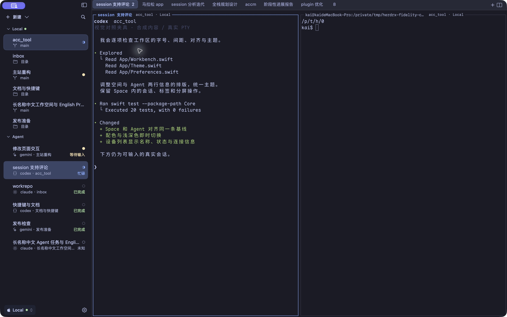

# HerdrX

A native macOS GUI for [Herdr](https://herdr.dev). Work with local and remote terminal spaces, tabs, split panes, and coding agents in one window.

Herdr owns sessions, processes, layouts, and agent state. HerdrX presents them through the existing Herdr API, with SwiftUI, AppKit, and a Ghostty terminal surface. Closing the GUI leaves Herdr sessions running. Opening a pane uses an ordinary attachment; if another client owns input, HerdrX observes it read-only. Reconnect retries without displacing that client; Take Control explicitly confirms a takeover. Restore Terminal Input checks that the foreground has returned to the shell before clearing stale keyboard and mouse reporting modes, preserving history.



## Install

Requires macOS 14 or later. Universal builds support Apple Silicon and Intel.

```sh
brew install --cask cleanwk/tap/herdrx
```

Update from **HerdrX → Check for Updates…**, or run:

```sh
brew update && brew upgrade --cask herdrx
```

[Direct downloads and release notes](https://github.com/cleanwk/herdrX/releases/latest) are also available. Releases use signed Sparkle updates but are not yet notarized by Apple. If macOS blocks the first launch, use **System Settings → Privacy & Security → Open Anyway**.

## Get started

1. [Install Herdr](https://herdr.dev/docs/install/) 0.9.3 or later on each device you want to use.
2. Open HerdrX. If local Herdr is stopped, click **Start Herdr**. This runs the existing `herdr server` command in the background. You can also start Herdr yourself.
3. Select or create a Space, then run `claude`, `codex`, or another CLI in its terminal. Herdr detects agents and reports their state.

Use **Settings → Connections** to add SSH devices or discover local named sessions. SSH uses your existing keys and configuration; Herdr must be running on the remote device. The default local socket is `~/.config/herdr/herdr.sock`.

Stopped local sessions show a start action. Custom socket paths show connection settings instead of guessing which server to launch. Temporary disconnections reconnect automatically; the info button exposes diagnostics when needed.

## Everyday controls

| Shortcut | Action |
| --- | --- |
| ⌘T | New terminal tab |
| ⌘⇧N | New Space |
| ⌘D / ⌘⇧D | Split right / down |
| ⌘⌥ arrows | Focus another pane |
| ⌘⇧Return | Zoom / restore pane |
| ⌘⌥R | Rename tab; also available by double-click or context menu |
| ⌘K | Search spaces, terminals, and agents |
| ⌘⇧J | Jump to an agent needing attention |
| ⌘⇧W / ⌘⌥W | Close pane / tab |
| ⌘, | Settings |

Drag terminal text to select it; **Copy on Select** copies once when you release and briefly shows “Copied”. Turn it off to retain a selection for ⌘C or the pane's Copy menu. Hold a drag at the top or bottom edge to extend through available terminal scrollback. With mouse reporting enabled, a click goes to the terminal app while a drag selects locally. Alternate-screen apps can only expose the history they render.

**Local Herdr theme** follows the local theme family; custom palette overrides and remote themes are not synced.

Settings also provides themes, terminal preferences, notifications, Tailcat connections, and access to Herdr plugins.

## Development

Use Xcode 27+, XcodeGen, and Go 1.27.1+ (for the Tailcat helper).

```sh
brew install xcodegen go
scripts/build.sh
scripts/test-pty.sh
scripts/test-tabs.sh
scripts/test-inputs.sh
scripts/test-panes.sh
scripts/test-selection.sh
python3 -m unittest discover -s scripts -p 'test_*.py'
scripts/package.sh
```

The build script runs Core tests and produces a universal app in `build/release/Build/Products/Release/`. Packaged archives go to `build/dist/`. For Xcode debugging, run `xcodegen generate` and open `HerdrX.xcodeproj`.

- [Architecture](docs/Architecture.md) · [Product scope](PRODUCT.md) · [Design](DESIGN.md)
- [Validation](docs/Validation.md) · [Release process](docs/Release.md) · [Contributor guidance](AGENTS.md)

## License

[MIT](LICENSE). Third-party licenses are listed in [Notices.txt](Resources/Notices.txt).
