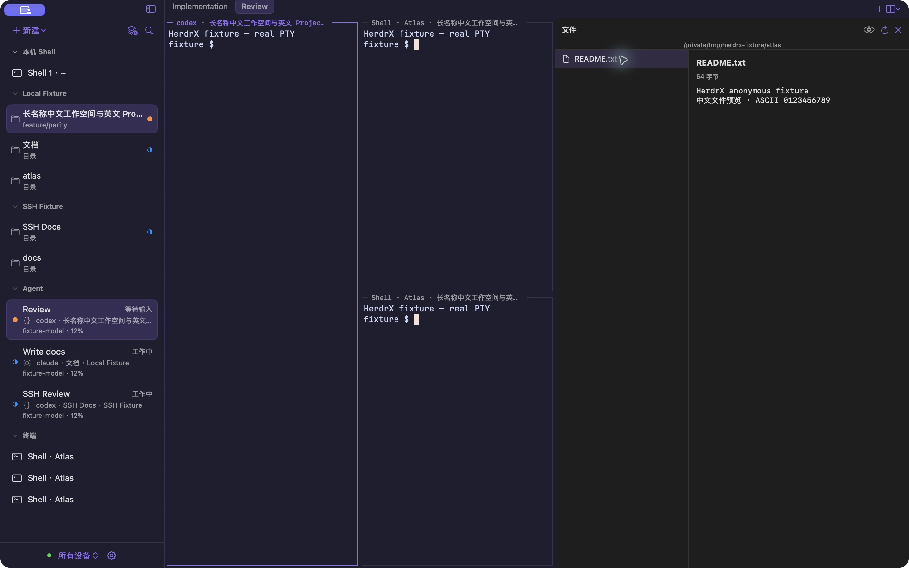

# HerdrX

<p align="center">
  
</p>

<p align="center">
  <strong>专为 macOS 打造的原生终端工作台</strong><br>
  在一处无缝掌控本机与远端设备上的 Space 工作区、分屏终端与编码 Agent
</p>

<p align="center">
  <a href="#安装与升级">安装</a> •
  <a href="#核心特性">特性</a> •
  <a href="#快速上手">快速上手</a> •
  <a href="#快捷键速查">快捷键</a> •
  <a href="#构建与开发">构建</a>
</p>

<p align="center">
  
</p>

---

## 什么是 HerdrX？

**HerdrX** 是一款专为高效开发者打造的 macOS 原生终端工作台（macOS 14+，通用架构同时支持 Apple Silicon 与 Intel）。

它结合了 **SwiftUI & AppKit** 的原生精致质感与 **Ghostty** 的硬件加速终端渲染能力，作为 [Herdr](https://github.com/herdrdev/herdr) 服务的现代化客户端，为你提供统一管理本机进程、SSH 远程主机、分屏会话与 Coding Agent 的全功能开发控制台。

无论日常本地写代码，还是同时调度多台服务器与后台 AI 编码代理，HerdrX 都能带来沉浸、流畅且低开销的操作体验。

---

## 核心特性

- **⚡️ 极致原生与 Ghostty 渲染**  
  纯正 macOS 原生架构，集成 libghostty 终端引擎直接渲染原始 ANSI 字节流。零输入延迟、GPU 加速绘制，终端数据吞吐与 UI 状态彻底解耦，哪怕高负载输出依然轻快如风。

- **🌐 跨设备与持久化会话拓扑**  
  一站式管理 Local 及多台远程 SSH 设备。会话状态由服务端（Herdr）持久托管，退出窗口或断开连接绝不意外终止远端服务，支持随时平滑接管与重新附着。

- **🤖 为 Coding Agent 深度定制**  
  原生集成 Herdr Agent 状态感知（运行中、等待输入、完成），告别轮询盲等。拥有精准的系统通知、未读状态标记与一键聚焦跳转（`⌘⇧J`）。

- **🪟 灵活自由的工作区与分屏**  
  支持 Space 多工作区隔离与多标签页管理。任意方向（向右 / 向下）随心分屏，快捷调整分屏比例，支持单键最大化聚焦（`⌘⇧Return`），更有快捷全局搜索（`⌘K`）快速定位目标。

- **📂 内置文件抽屉与跨端传输**  
  按需加载的侧边文件树，支持最多 2 MiB 的文本与图片原生只读预览；集成双端文件管理器，轻松在本机与远程 SSH 主机间单文件传输与冲突处理。

- **🧩 兼容 Herdr 原生扩展生态**  
  沿用 Herdr 原生 TOML 插件契约，图形化管理插件启停、执行动作、阅读执行日志或以独立标签打开扩展终端面板。

---

## 安装与升级

HerdrX 通过官方 [cleanwk/homebrew-tap](https://github.com/cleanwk/homebrew-tap) 分发，支持一键安装与升级：

```sh
# 安装
brew install --cask cleanwk/tap/herdrx

# 升级
brew update && brew upgrade --cask herdrx
```

> **macOS 首次打开提示**  
> 当前版本采用本地签名分发。若首次启动被 macOS 安全策略拦截：  
> 1. 打开 **系统设置** → **隐私与安全**，滚动到底部点击 **仍要打开**；  
> 2. 或在终端执行单应用放行命令：  
>    ```sh
>    xattr -dr com.apple.quarantine /Applications/HerdrX.app
>    ```

发布历史与分发细节参见 [Release 文档](docs/Release.md)。

---

## 快速上手

1. **开箱即用**：启动 HerdrX 即可直接获得一个本地原生 Shell，普通终端无需配置任何后台服务。
2. **连接 Herdr 与远端**：
   - 打开 **Settings (⌘,)** → **Devices**，即可添加本机命名会话或远程 SSH 连接。
   - 本机默认读取 `~/.config/herdr/herdr.sock`（需对应设备运行 Herdr 0.9.3+）。
   - SSH 连接直接使用系统原生 `ssh` 命令、现有密钥和 `~/.ssh/config` 配置。
3. **新建与协同**：
   - 按 **⌘N** 打开 New Agent 菜单，根据当前目录上下文唤起编码智能体。
   - 按 **⌘⇧N** 快速基于当前目录新建 Space 工作区。

---

## 快捷键速查

| 快捷键 | 功能说明 |
| :--- | :--- |
| **⌘N** / **⌘T** | 新建 Agent / 新建当前设备终端 |
| **⌘⇧N** / **⌘⌥T** | 继承当前目录新建 Space / 新建 Tab |
| **⌘D** / **⌘⇧D** | 向右分屏 / 向下分屏（继承当前目录） |
| **⌘⌥ 方向键** | 在分屏间切换焦点 |
| **⌘⌃ 方向键** | 动态调整分屏比例 |
| **⌘⇧Return** | 最大化 / 还原当前分屏 Pane |
| **⌘1 … ⌘9** | 快速切换至第 1 ~ 9 个标签 |
| **⌘⇧[** / **⌘⇧]** | 左右轮换标签 |
| **⌘K** | 全局搜索 Space、Shell 与 Agent（支持拼音与首字母） |
| **⌘⇧J** | 一键跳转至等待输入或完成未读的 Agent |
| **⌘B** | 显示 / 隐藏侧边栏 |
| **⌘⇧E** | 展开 / 折叠文件预览辅助区 |
| **⌘⇧F** | 打开双端文件管理器 |
| **⌘⇧R** | 恢复终端输入模式（不发送 Ctrl-C） |
| **⌘W** | 关闭弹窗或当前 Pane |
| **⌘⌥W** / **⌘⇧W** | 关闭当前 Tab / 关闭当前 Pane |

---

## 构建与开发

### 环境要求

- macOS 14.0+
- Xcode 15+（推荐最新版本）
- [XcodeGen](https://github.com/yonaskolb/XcodeGen) 与 [Go](https://go.dev/)（用于 Tailcat helper 通道构建）

```sh
brew install xcodegen go
```

### 构建与打包

```sh
# 生成工程并编译
scripts/build.sh

# 生成分发打包产物 (.app 及 zip 包)
scripts/package.sh
```

生成的 App 产物位于 `build/release/Build/Products/Release/HerdrX.app`，打包好的归档与校验文件位于 `build/dist/`。

### 日常调试与测试

生成工程后直接使用 Xcode 打开：

```sh
xcodegen generate
open HerdrX.xcodeproj
```

运行核心单元测试与协议集成测试：

```sh
# 核心数据与协议测试
swift test --package-path Core -c release

# PTY 与 SSH 传输测试
scripts/test-pty.sh
scripts/test-ssh.sh
```

更多架构设计请参阅 [Architecture](docs/Architecture.md) 与 [Validation](docs/Validation.md)。

---

## 开源许可

本项目基于 [MIT License](LICENSE) 开源。第三方组件许可参见 [Notices.txt](Resources/Notices.txt)。
