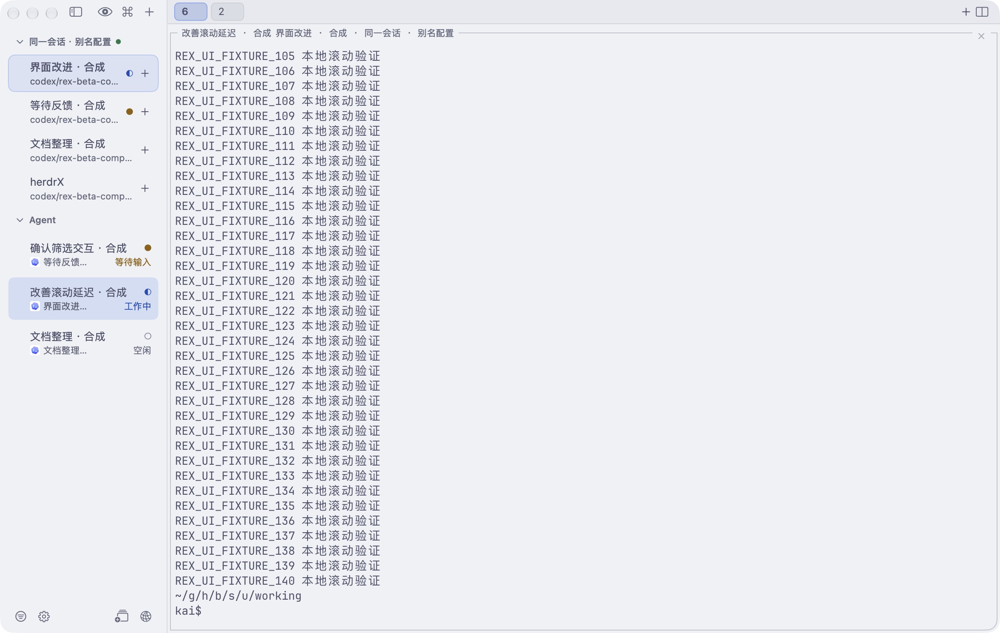
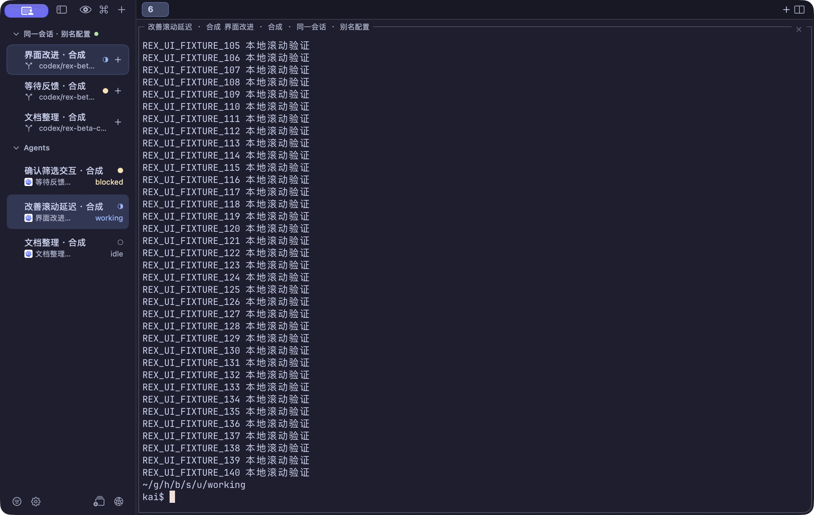

# Sidebar toolbar follow-up — 2026-10-26

## Result

Rex's live accessibility tree confirms top actions Hide Sidebar / Activity / Command Palette / New Tab and bottom actions Filter Hosts / New Session / Add Remote Host. HerdrX reuses that placement for equivalent existing capabilities, adding its Settings control next to Device Filter. No domain/protocol change. Top actions now occupy one row instead of three; all toolbar icons share 13pt symbols and 26pt hit areas. Activity/device filtering stays visible through selection treatment and accessible values.

New Space uses a plain button for quickSpace and a context menu for the existing name/directory sheet. Search uses openSearch, new tabs use create, and Add Device uses connectionFormRevision, Connections selection and native openSettings. Space branch/folder glyphs were removed at the user's follow-up request; the two text lines share one leading edge, 3pt gap and 6pt vertical padding. Agent marks are unchanged.

## Checks actually run

- Debug arm64 native app built successfully after the final Space edit using Xcode 27; ad-hoc signed isolated copy.
- Core Release: 88 tests passed, zero failures. No Core implementation changed.
- Native interaction in disposable session `herdrx-sidebar-tools-20261026`, separate `HERDRX_STATE_DIR=build/sidebar-toolbar/ui-state`, dedicated bundle `io.github.cleanwk.herdrx.toolbar-check`. Three Agent labels/states are synthetic; shells, tabs, Spaces and RPC are real.
- 1200×760pt window, 200pt sidebar: Chinese/light and English/dark toolbars inspected. Final Space typography inspected Chinese/light. Dark screenshot precedes the text-only Space follow-up and is evidence for the toolbar only.
- Activity menu switched to Working, retaining the current terminal; Search opened and canceled; Device Filter opened with grouped device count; Add Device opened a fresh Connections form; Space context menu opened the name/directory form and Escape canceled; top + created a real second tab; bottom stack + created a real fourth Space; sidebar hide and restore worked after removing the fixture's command-line showSidebar override.
- A clone relaunch initially exited with its parent shell; CUA reopened that dedicated clone without the fixture environment, displaying ordinary saved connections. No mutations were performed there; that clone was stopped and relaunched in the named fixture before continuing. Subsequent clones use detached process launch. The installed app was not replaced.
- SwiftUI Debug stores code in HerdrX.debug.dylib: final validation copies the whole MacOS directory, not just its launcher. Earlier captures with stale code are not acceptance.

## Limits

No release/universal packaging, CI suite, remote connection mutation, exhaustive VoiceOver, all-theme matrix or input-to-pixel timing in this pass. Search dismissal was checked; physical keyboard focus restoration after dismissal was not independently asserted. Settings/Add Device routing was checked before the final Space-only edit. Current screenshot evidence does not cover every menu hover state.

Logs, disposable setup and app bundle are under `build/sidebar-toolbar/`. Existing untracked Core/Package.resolved was left intact.

Cleanup: stopped only the dedicated test client, confirmed all five fixture panes still existed after detach, then stopped the explicitly named disposable server. Final ad-hoc signature verification, design detector (no findings for Swift sources) and git diff --check passed.
