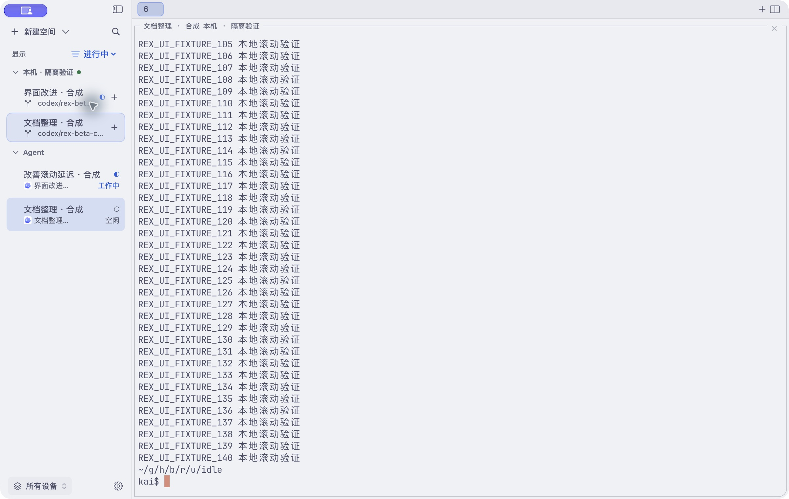

# Rex Beta 与 HerdrX：交互对比与性能调查

记录：2026-10-26。前半部分记录改动前的竞品观察和只读诊断；文末“获准实施后的改动与验证”记录用户授权后的代码、测试和未完成的界面验收。

## 对象与证据边界

- 实际运行的 Rex Beta：`0.1.0 (1408)`，PID 64594。
- 实际运行的 HerdrX：`0.1.22 (23)`，PID 49113。
- 核对的仓库提交：`1006395`（Optimize hot UI, search, and PTY paths），仓库 `VERSION` 仍为 `0.1.21`。没有重建、替换安装版，也没有证明安装二进制与这个提交完全一致。源码发现与运行观察分别记录。
- 平台：arm64，macOS 27.0.1 (26A434)。两个窗口的主题、字体、内容和连接数量没有归一化；不能将截图或进程内存当成同负载性能排名。
- 使用原生界面工具观察真实窗口、辅助功能树和截图；使用已安装 Rex CLI 查询版本、客户端动作并切换活动视图/命令面板；使用 macOS `sample` 采样。
- Herdr 诊断仅调用现有 `pane.list`、`tab.list`、`agent.list`、`pane.process_info`、`pane.get` 和 `ping`。没有发送终端输入、执行 `pane.scroll`，也没有创建、关闭或改名任何服务器对象。
- 两个应用最终保留原来的选择。Rex Activity 恢复 Off，Show idle processes 恢复勾选；菜单和表单关闭。HerdrX 新建空间表单只打开并取消。

完整采样、临时测量脚本和工作台截图保存在本地 `build/rex-comparison/`。截图包含用户终端内容，不纳入持久仓库证据。下列 JSON 只保留测量值和连接别名，不包含终端内容、密钥或完整连接配置。

## 值得借鉴的交互

| 优先级 | Rex 的实机表现 | HerdrX 的当前表现 | 建议 |
| --- | --- | --- | --- |
| P1 | 侧栏 Tab 直接显示可读任务标题和 Agent 图标 | Agent 主标题显示 `6、1、1`；搜索和 tooltip 却能显示更有意义的信息 | 先修标题优先级。数字 Tab 标签不应自动盖掉有效任务标题；保留可辨认的用户自定义名称。 |
| P1 | Activity 是常驻的一键视图切换；过滤菜单还有 Show idle processes 和 Show each process in tabs | Agent 独立列在所有设备/Space 之后，没有直接的活动筛选 | 增加客户端视图过滤：全部、进行中、需处理。需处理包含等待输入和未读完成；不要把它们混同于 working。沿用服务端状态与现有 Attention。 |
| P1 | 主机选择被收纳在 Filter Hosts | 当前显示 7 台设备，实际存在三对指向相同远端 socket 的连接，列表和过滤器都重复 | 识别手动配置与自动导入的等价连接，先提供清晰来源和会话身份，再安全复用连接/整理展示；不要按显示名称直接删除配置。 |
| P2 | 全局 New Tab、每个 Session 旁的 New Tab，以及底部 New Session 的作用范围可区分 | 左上“新建”实际快速创建 Space；下拉只含“新建空间…”；Tab 的加号远在右侧 | 明示“新建空间”，把“在此空间新建标签页”放到对象旁，并保留全局快捷键。需要参数时再打开现有表单。 |
| P2 | Session 标题弱化，任务条目承担主要视觉注意力；普通模式行紧凑，Activity 增加状态/经过时间 | Device、Space、底部 Agent、顶部数字 Tab 同时争夺导航注意力；多行“目录”占位却不增加辨识度 | 常规导航聚焦 Space 与其 Tab；活动视图聚焦 Agent。无有效分支时显示短路径或省去空泛副标题，降低重复层级与边框重量。 |
| P2 | 命令面板直接列出命令、快捷键和后续入口，覆盖会话和 Tab | 搜索已支持空间、终端、Agent 和命令，但空查询前排主要是对象，入口只叫“搜索” | 保留现有搜索能力，改善对象/命令识别和快捷键提示。是否换成轻量浮层应另做键盘、IME、取消和焦点验收。 |
| P2 | Activity 下关闭 Show idle processes 后，当前选中的空闲 Tab 仍保留，终端没有被替换 | 目前没有相应状态筛选 | 过滤只改变导航呈现；当前工作面保持可用，必要时标明它位于过滤范围外。不要因状态变化突然切走任务。 |

Activity 与“仅 working”不是同义词：开启 Activity 且允许 idle 时，当前空闲 Agent 仍显示，并附 Idle 和经过时间。上述建议借鉴的是可控的信息密度与任务导向。没有验证 Rex 对多台远程主机、全部 Agent 状态和快速并发状态变化的完整规则。

HerdrX 应保留已有的原生快捷键、中英文、搜索取消恢复、服务器权威身份和已挂载终端复用。这次检查中搜索有结果/无结果路径及新建空间取消均可完成。无需通过复制 Rex 的所有功能来改善这些基础路径。

## 两个具体问题的来源

### 数字 Tab 标签覆盖 Agent 任务

[`DisplayTitle.agentRow`](../../Core/Sources/HerdCore/Presentation.swift) 将 `authoredTask(tab.customLabel)` 放在 `terminalTitle` 之前。`authoredTask` 只排除工具名，没有像 `meaningful` 一样排除纯数字，而 `Item.customLabel` 直接读取服务端 `label`，没有证明该字段来自用户手工命名。

本次只读数据核对：三个 Agent 的 pane label 均为空，所属 Tab label 分别为 `1、1、6`，Agent title 为空，但都有 terminal title。实际侧栏恰好显示这些数字。搜索/tooltip 与侧栏采用不同标题路径，导致同一个对象在不同入口的可辨识度不同。

修正应针对显示优先级，不改写服务端名称。若要严格区分用户刻意命名的数字与自动标签，需要先确认 Herdr 是否提供来源信息；不能在客户端凭空标记“用户已命名”。

### 自动导入与手动连接重复

[`HerdrMachines.changes`](../../Core/Sources/HerdCore/HerdrMachines.swift) 用 `source` 匹配受管理配置，手动条目的 source 为空，自动导入因此另建条目。

本机配置有 1 个 local、3 个手动 SSH socket、3 个自动导入的同主机 default session。正在运行的 HerdrX 拥有 6 条 SSH 转发；每台远程各两条，目标都是该主机的 `/root/.config/herdr/herdr.sock`。这解释了当前列表重复，不证明所有同名主机都可合并。手动配置与导入配置的保存语义、不同 session/socket 和既有偏好必须保留。

## 性能：实测结果

### 滚动之前已经有同步依赖链

[`Desk.scrollTerminal`](../../App/Desk.swift) 的普通 Shell 历史滚动路径是：

```text
滚轮事件批次
  → await pane.process_info
  → 验证空闲 Shell
  → await pane.get，读取当前 offset 与最大 offset
  → await pane.scroll，发送绝对 offset
  → 等待终端内容更新
```

TUI 路径也要等待第一步 `pane.process_info`，再转发滚轮。`Terminal.enqueueScroll` 会合并后续到达的事件，但不会消除前面这段等待。`RPC.call` 在后台队列执行，不阻塞主线程本身；用户仍要等这些查询完成才收到滚动效果。

按生产代码的方式，每个请求新开一个 Unix socket，远程复用 HerdrX 已有 SSH 转发。每个端点先预热一组，再测 10 组 `pane.process_info → pane.get`，不同端点并行、每组内部串行。

| 端点 | 两次查询合计中位数 | 最小—最大 | 样本 |
| --- | ---: | ---: | ---: |
| 本机 | 1.01 ms | 0.81—1.82 ms | 10 |
| 泡芙 DC9 | 1,022.98 ms | 817.37—1,167.39 ms | 10 |
| 泡芙旧机 | 1,172.38 ms | 1,016.45—1,541.09 ms | 10 |
| Burberry | 2,245.97 ms | 2,156.76—2,358.42 ms | 10 |

这些是当前连接上的读取时间，**不含 pane.scroll、终端输出传输或绘制，也不是实际手势到像素的时间**。它们包含传输、远端调度、服务端处理和客户端解码，不能全部称为网络 RTT。

因远程值异常高，另在 Burberry 做了三轮完全串行复核，不并行测其他端点。仅 277 字节响应的 `ping` 分别为 1,879.91 / 1,918.67 / 1,123.51 ms；process_info 响应 286 字节、pane.get 响应 459 字节，依然处在约一秒量级。说明控制通道/服务端响应本身就很慢，数据体积不足以单独解释它；没有进一步隔离 SSH、网络和服务端调度的各自占比。

原始值：[read-latency.json](evidence/read-latency.json)、[read-latency-followup.json](evidence/read-latency-followup.json)。测量没有改动远端终端或服务器配置。

### 空闲和简单 UI 操作没有证明持续的主线程阻塞

两个应用各做一次同时间段的 5 秒 `sample`。HerdrX 主线程 3,800 个采样点中，最大的事件循环等待分支为 3,798；Rex 为 3,840 / 3,841。两者均能看到 `SwiftUI App.main → AppKit`，Rex 另有 NIO 与独立终端线程。这只证明所观察的线程结构，不足以推断 Rex 的全部渲染或缓存架构。

HerdrX 另有 20 秒采样，期间包括设备过滤器、搜索打开/输入/取消的自动化观察。13,924 个主线程采样点中，最大的事件循环等待分支为 13,280；活跃栈包含辅助功能文本解析与 UI 更新。没有捕获可据此认定为主因的持续主线程热点。该采样受工具 AX 读取影响，不能用其样本比例计算 FPS、CPU 占比或短暂卡顿时长。

采样时物理 footprint 为 HerdrX 176.9M、Rex 303.1M；内容、连接与生命周期不同，数值不用于优劣结论。[stack-summary.json](evidence/stack-summary.json) 保留采样时间与说明。

## 性能：源码确认、尚未量化的风险

1. **更新范围过大。** `Workbench` 订阅同一个拥有大量 Published 字段的 `Desk`；会话、状态、分支、选择等共享通知域。`publish` 在快照变化后运行 attention、reconcile、reindex。现有相等性检查与索引优化有效，但没有把更新依赖缩到受影响的区域。要用 SwiftUI Instruments 测真实更新次数与耗时，不能把 Published 字段数直接换算成重绘次数。
2. **布局请求与状态刷新耦合。** `select` 和当前设备 reconcile 都会进入 `ensureAttachments`，重新调用 `layout.export`，完成后发 `objectWillChange`。已有缓存允许先显示，不能声称所有 Tab 切换都会等待 RPC；但没有布局变化时仍有额外查询和后续更新。
3. **绘制仍存在无条件失效。** `TerminalCanvas.updateNSView` 已比较输入以跳过无关 layout，但始终 `markChromeForDisplay`；`Tabs.updateNSView` 也无条件标记 strip 和按钮重绘。可以使用显式主题/外观版本和具体显示数据变化来缩小失效；先测在真实状态负载下是否值得改。
4. **滚动契约有边界。** 当前 CLI schema 的 `PaneScrollParams` 只有 `pane_id` 和绝对 `offset_from_bottom`，没有在该方法内发现相对滚动或前台模式参数。先查现有 attach/事件能力能否安全减少读取；如果缺少满足要求的契约，应报给 Herdr 上游。不能随意跳过 TUI 判断或创造客户端并行协议。

已有工作不应推倒重来：终端字节没有进入 Published UI 状态，已访问的终端表面继续挂载、隐藏 surface 避免 resize，主题色/标题/索引已有缓存，Pane 操作已有 scoped snapshot。这些是继续优化的基础。

## 建议实施顺序与验收

1. **先处理当前最有证据的延迟与混乱：** 排查异常慢的远程控制通道；降低滚动关键路径的串行查询；识别等价连接；修正侧栏数字标题。保留失效检查、服务端身份、输入模式正确性和失败后的可用内容。
2. **然后重整侧栏的任务路径：** 全部/进行中/需处理过滤、明确的新建空间入口、对象旁的新建 Tab、减少空泛元数据。优先改善信息架构与点击路径，再微调颜色、边框和动效。状态经过时间只有在 Herdr 提供可靠时间信息时才显示；当前 Item 模型没有它。
3. **最后以实测收紧 UI 更新：** 分离导航/连接状态/终端 chrome 的观察依赖，缓存已确认布局，缩小需要重算和重绘的范围。是否改成 AppKit 列表需依据 profile，不先做技术栈替换。

下一轮验收需要固定 Release 二进制、主题/字体、窗口尺寸、刷新率和隔离数据，使用明确命名的 disposable Herdr session 与 `HERDRX_STATE_DIR`，覆盖多 Tab 切换、侧栏过滤/滚动、后台持续输出、Agent 状态变化和真实远程延迟。

建议把首个视觉反馈与最终服务器确认分别计时，记录 p50/p95、长帧、hitch、CPU、surface 身份和 resize 次数。可以先约定本地热切换/过滤 p95 ≤ 100 ms、动作反馈 ≤ 50 ms 作为待验证目标；这些不是本次已达到的结果。帧截止时间要按实际刷新率判断：60 Hz 约 16.7 ms，120 Hz 约 8.3 ms。服务器未确认前可显示忙状态，不能伪造 Pane 身份或布局。

Apple 的 [SwiftUI performance guidance](https://developer.apple.com/documentation/xcode/understanding-and-improving-swiftui-performance) 和 [hitch guidance](https://developer.apple.com/documentation/xcode/understanding-hitches-in-your-app) 支持按视图更新依赖和帧截止时间诊断。历史 [组件性能记录](../ui-polish/PERFORMANCE.md)、[AX 往返测量](../ux-audit/PERFORMANCE.md) 与 [Pane 操作延迟记录](../connection-recovery/action-latency.md) 各有明确边界；它们不能替代这些体验指标。

## 对比调查阶段完成与未完成

完成：两个运行应用的侧栏/过滤/命令入口观察；Rex Activity 与 idle 过滤开关检查并恢复；HerdrX 搜索有结果/无结果/取消与创建表单取消；三次原生进程采样；当前连接只读 RPC 测量与慢端点串行复核；相关展示、连接导入、布局、滚动、状态发布代码及 Herdr schema 核对。

未完成：同负载 Rex/HerdrX 帧率和输入到像素比较；两边新建/关闭实际会话的时延；真实滚动手势测量；大量后台输出/状态变化压力测试；Rex 内部源码审计；远程高延迟的网络/SSH/服务端分层定位；完整 VoiceOver/IME/多主题验收。

对比调查阶段没有应用代码变更，也未运行构建或测试。后续实施见下节；调查本身不代表修复或流畅度验收。


## 获准实施后的改动与验证

用户确认“可以改吧”后，在 `codex/rex-beta-comparison` 实施，保留 `1006395` 为代码基线。没有修改 VERSION、发布版本或替换 `/Applications/HerdrX.app`。

### 行为契约

- 左上明确写“新建空间”；每个 Space 右侧和右键菜单增加“在此空间新建终端标签页”。沿用 `pane.get → tab.create → scoped refresh`，捕获目标 Space、Pane、terminal、endpoint 和 transport。失败保留当前终端，异步期间删除/替换目标不提交新建。
- 常驻活动菜单：全部活动、进行中、需处理。进行中使用服务端 `working`；需处理使用现有 Attention（等待输入、完成未读）。筛选 Space 和 Agent，保留当前 Space/Agent；不改变终端选择、服务端状态或会话生命周期。无匹配结果可以恢复全部活动。
- Agent 行不再让数字 Tab 标签覆盖有效任务标题。用户直接给 Pane 起的数字名字仍保留；可辨认的 Tab 名和 Agent 标题保持原优先级。
- 无有效 Git 分支时显示目录末段，完整路径和可选 Git 诊断保留在 help；保留最后有效分支，不把 Git 失败当作连接故障。
- 侧栏、设备过滤器与“下一个需处理”按等价 endpoint 合并入口。SSH 必须同时匹配 target、port、sshConfig 和实际 socket；未解析的 named session、不同 socket、不同 SSH 配置不合并。同组优先保留当前选中连接身份。保存的配置、source 所有权、设置编辑和已有连接均保留。
- 合并是**导航呈现**；本轮没有实现 SSH 连接池，也没有消除旧配置产生的重复后台轮询。Search 的原始对象索引仍保留各连接身份。

### 性能路径

滚轮批次同时发出只读 `pane.process_info` 和 `pane.get`。只有完成当前批次的前台进程验证，才决定 TUI 转发或 Shell 历史滚动；无缓存的模式推断。TUI 不等待较慢的历史响应，取消的 speculative read 仍可能在底层 RPC 的 3 秒 timeout 内完成，但不能发送输入或修改会话。Shell 验证 terminal ID 后按服务端 offset 计算绝对滚动。等待期间积累的滚轮样本加入当前批次，避免为已有积压重新预检。

布局导出按连接 transport、Tab、Pane 集合和服务端几何缓存；忽略 focus/标题等元数据，不重复取消同一请求，不在相同结果时再次发布 UI 通知。切换后只接受当前目标/transport/几何仍匹配的响应；几何变化时旧分隔条不可操作。显式修改比例会失效缓存，即使单元格四舍五入后矩形未变。终端对象和 attachment 保持复用。

### 已完成检查

- Core Release 测试：88 项通过，零失败，含数字 Tab 标题、endpoint 分组/隔离、Activity 状态语义、取消/失效滚动目标。
- 真实 Unix socket 延迟夹具：两次各 250ms 的读取并行预检约 251ms 完成；1 秒 history 响应不拖住 250ms foreground 分支。该数值不含滚动写入、输出传输和绘制，不能声称端到端滚动快两倍。
- Release 原生回归：已有 16 项 selection/floating 测试通过，覆盖真实 NSEvent 滚轮、前台验证门禁、滚动方向、选择、输入法提交和主题语义。
- 新增/保留的原生 actions 套件 4 项通过：20 次元数据及 focus 变化不重复导出布局、Activity 过滤和返回 Tab 复用终端；显式修改比例即使几何单元格未变也重新导出；非选中 Space 的新建目标、失败恢复及 stale Pane 阻止提交；预检期间三份滚轮样本合并为一批。与上述 16 项合计 20 项原生回归通过。
- `scripts/test-coexistence.sh` 通过，使用真实 Herdr/PTY 验证 attach/observe、前台 Shell 门禁、历史上下滚动、合成 TUI 和 stale mouse capture。
- `scripts/build.sh` 完成 Core Release 测试与通用 app 构建；最后 UI 调整后再次生成最终 arm64/x86_64 Release app，`codesign --verify --deep --strict` 和架构检查通过。日志 `build/rex-comparison/release-final.log`。没有打包发布或安装。
- 英文/简中字符串通过 plutil、键无重复；文档本地链接、设计 JSON 和 `git diff --check` 通过。

### 原生界面与实际交互验收

已建立一次性 Herdr session `herdrx-rex-ui-20261026`，独立 `HERDRX_STATE_DIR=build/rex-comparison/ui-state`，先运行 Debug 专用 bundle `io.github.cleanwk.herdrx.rex-ui-check`，最终复核使用当前通用 Release app 的专用副本 `io.github.cleanwk.herdrx.rex-final-check`（仅副本关闭 updater）。终端、历史与 workspace RPC 为真实 Herdr；三个 Agent 的 working/blocked/idle、标题和来源 `synthetic-rex-ui-validation` 均为明确标记的合成数据。两个本地配置故意指向同一测试 socket 验证重复展示。未改动生产会话。

用户解锁后完成两轮有边界的原生检查：首轮发现活动菜单多了一层、单设备 Agent 行仍重复设备名；统一修正后在最终 Release 副本确认。1200×760pt 窗口、简中/light、200pt 最窄侧栏下，主要动作和状态可辨认，长分支名按行截断。首轮 260pt 检查保留为临时历史截图，持久截图为最终 200pt 版。

- 活动菜单变为单层；全部/进行中/需处理按约定过滤。选择 idle Agent 后切换进行中，当前 idle 行、Space 和终端仍保留。
- 当前为新建 Shell、所有合成 Agent 改为非 working 后，出现“没有符合条件的活动”和“显示全部活动”；点击恢复列表，当前 Tab 不变。
- 两个配置指向同一个本地 socket，设备过滤器显示“1 台设备 · 1 台已连接”，设置数据仍有两个配置。
- 非选中“等待反馈”Space 旁的新建按钮真实创建 `w2:t2 / w2:p2`，cwd 为该 Space 的 blocked 目录；CUA 粘贴并执行 `CONTEXT_NEW_TAB_OK` 后，服务端 pane.read 读到输出，确认新建后的键盘焦点。最终 Release 副本也成功从 idle Space 旁创建 `w3:t2 / w3:p2`。
- CUA 在真实 Shell 历史区滚动，服务端 offset 实测 `0 → 107 → 0`。本机 CUA down/up 名称分别产生查看旧历史/回到底部的效果；没有据此改变生产滚动方向，也未将自动化工具方向当作物理触控板验收。
- 屏幕再次锁定时，已完成的检查不重做。仅终止本轮拥有的测试 GUI 进程；停止后 5 个服务端 shell PID 完全一致。随后用既有 CLI 停止唯一命名的测试 session，socket 消失。生产会话与安装版不受影响。



验收范围：上述简中/light 场景通过。未做最终英文/dark 渲染、完整 VoiceOver、物理触控板方向/延迟、同负载 Rex 对比、真实远程手势到像素、p95/hitch/帧率测试，未声称远端控制通道的秒级延迟已修复。Git 异常时的目录短名保持源代码契约，本轮未重新注入缺少 Git 的失败场景。

临时日志、bundle、fixture 与原始结果在 `build/rex-comparison/`；持久的合成测试摘要在 `evidence/implementation-checks.json`。
